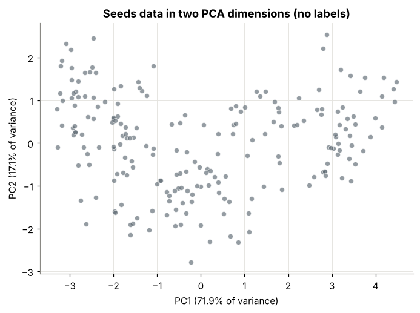
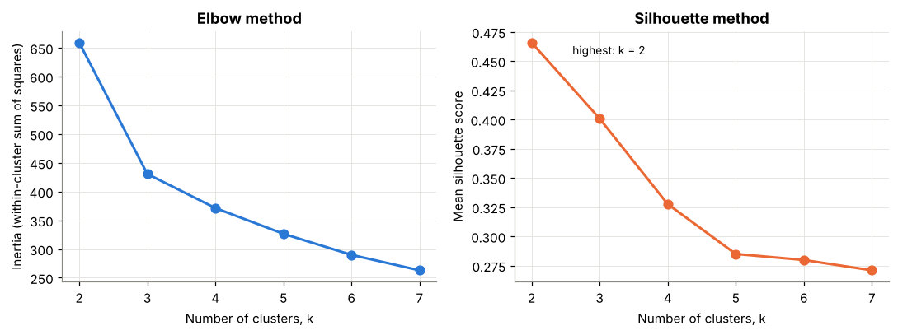
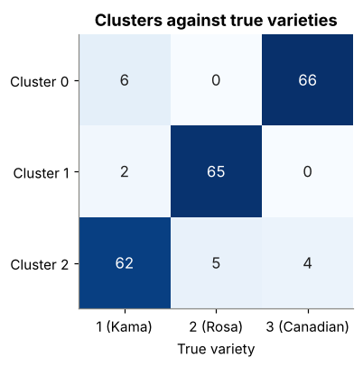
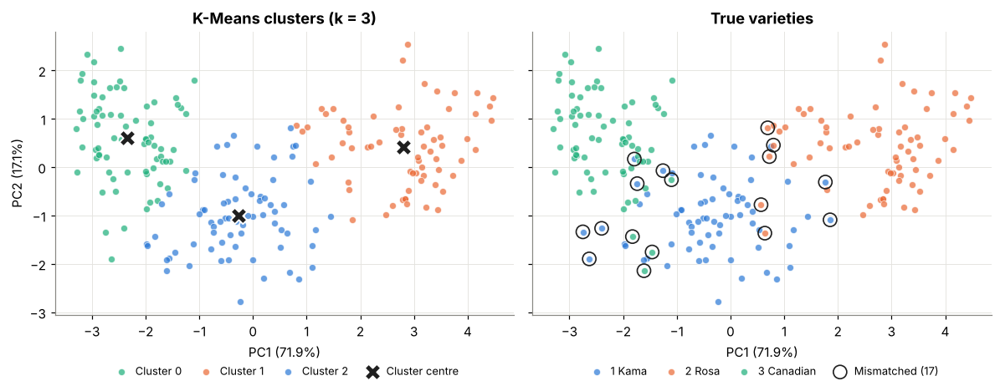
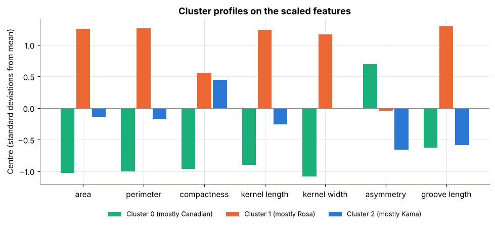

# Wheat Seeds Clustering: Finding Varieties Without Labels

Final project (Option 3) for the course *Machine Learning with Python (AUTH_LEAP)*.

This project asks how much of the real variety structure in a set of wheat kernels can be recovered with unsupervised learning alone. The kernels are clustered with K-Means on seven geometric measurements, and the true varieties are used only at the end as an answer key.

| | |
|---|---|
| **Notebook** | [`Seeds_Clustering.ipynb`](Seeds_Clustering.ipynb)  |
| **HTML export** | [`Seeds_Clustering.html`](Seeds_Clustering.html)  |
| **Main result** | k = 3 clusters, purity **0.919** (193 of 210 kernels matched) |

## 1. Problem statement

An agricultural co-op receives deliveries of mixed wheat grain without labels. Before paying for a labelling or sorting process, it wants to know how many varieties are plausibly present and how cleanly they separate on a few simple measurements.

**Central question:** how much of the real class structure can clustering recover without using the labels?

## 2. Data

The [Seeds data set](https://archive.ics.uci.edu/dataset/236/seeds) (UCI Machine Learning Repository, also on OpenML) contains 210 kernels, 70 from each of three wheat varieties: **Kama (1)**, **Rosa (2)** and **Canadian (3)**. Each kernel is described by seven measurements taken from X-ray images:

| Feature | Meaning |
|---|---|
| `area` | kernel area |
| `perimeter` | kernel perimeter |
| `compactness` | 4π · area / perimeter² |
| `kernel_length` | length of the kernel |
| `kernel_width` | width of the kernel |
| `asymmetry` | asymmetry coefficient |
| `groove_length` | length of the kernel groove |

The notebook downloads the data from OpenML. A copy is stored in [`data/seeds.csv`](data/seeds.csv) and is read automatically if OpenML cannot be reached.

## 3. Method

1. **Scaling.** All features are standardised with `StandardScaler`, because K-Means uses Euclidean distance and features on larger scales would otherwise dominate.
2. **Exploration without labels.** PCA reduces the seven scaled features to two components for plotting.
3. **Choosing k.** K-Means (`n_init=10`, `random_state=42`) is fitted for k = 2 to 7. Inertia (elbow method) and the mean silhouette score are compared.
4. **Clustering.** The final model uses k = 3.
5. **Evaluation against the labels.** Only after clustering are the varieties revealed. The agreement is measured with a cross-tabulation and a purity score, and the clusters are described by their centres in original units.

## 4. Results

### Structure before clustering

The first two principal components explain **89%** of the variance (PC1 71.9%, PC2 17.1%). PC1 is mainly a size axis; PC2 is driven by asymmetry and compactness. The points form a curved band with three loose concentrations and no clear gaps.



### Choosing the number of clusters

| k | 2 | 3 | 4 | 5 | 6 | 7 |
|---|---|---|---|---|---|---|
| Inertia | 659.2 | 430.7 | 371.3 | 326.5 | 289.8 | 263.0 |
| Silhouette | **0.466** | 0.401 | 0.328 | 0.285 | 0.280 | 0.271 |



The two diagnostics disagree. The silhouette is highest at k = 2, but the elbow is at k = 3, where the largest drop in inertia ends. k = 3 was chosen because the elbow is clear and three concentrations are visible in the PCA plot.

### Agreement with the true varieties

| Cluster | Kama | Rosa | Canadian | Majority | Share |
|---|---|---|---|---|---|
| 0 | 6 | 0 | **66** | Canadian | 0.917 |
| 1 | 2 | **65** | 0 | Rosa | 0.970 |
| 2 | **62** | 5 | 4 | Kama | 0.873 |

**Purity = 0.919.** 17 kernels (8%) sit in a cluster dominated by another variety.





### Cluster profiles (original units)

| Cluster | Variety | Area | Perimeter | Compactness | Length | Width | Asymmetry | Groove |
|---|---|---|---|---|---|---|---|---|
| 0 | Canadian | 11.86 | 13.25 | 0.848 | 5.23 | 2.85 | 4.74 | 5.10 |
| 1 | Rosa | 18.50 | 16.20 | 0.884 | 6.18 | 3.70 | 3.63 | 6.04 |
| 2 | Kama | 14.44 | 14.34 | 0.882 | 5.52 | 3.26 | 2.71 | 5.12 |



Rosa kernels are the largest on every size measure. Canadian kernels are the smallest, least compact and most asymmetric. Kama kernels lie between the two in size and have the lowest asymmetry.

## 5. Interpretation

- Clustering without labels recovered most of the real structure: 92% of the kernels fall in a cluster whose majority variety is their own.
- **Rosa** is separated most cleanly, since its kernels are clearly larger than the rest.
- **Kama and Canadian** are the hardest pair to separate (10 kernels cross between their clusters). Kama sits in the middle of the size range and overlaps both other varieties.
- **Limitations.** The value of k was a judgement between two diagnostics that did not agree, and K-Means will always return the number of groups it is given. Purity rewards larger k, so it should be read together with the cross-tabulation. The PCA plots show only two of the seven dimensions (about 11% of the variance is missing), so overlaps in the plot do not always mean overlaps in the space where the clustering was done.
- **Ethical point.** The clusters should not be treated as fixed, certified varieties. About one kernel in twelve would be mislabelled, and these errors concentrate at the borders between groups. Any sorting or pricing decision should be checked on a labelled sample first.

## 6. Reflection

**What worked well.** Standardising the features and following the order of the workflow kept the evaluation honest. Setting the labels aside until the end meant the choice of k could not be tuned to match the answer. The side-by-side PCA plot with the mismatched kernels circled made the result much easier to explain than the numbers alone.

**What was difficult.** The elbow and the silhouette pointed to different values of k. Deciding between them required looking at several pieces of evidence together. It was also tempting to read the PCA plot as if it showed the full clustering, when it is only a projection.

**What could be improved.** 
- compare K-Means with other methods such as a Gaussian mixture model;
- use measures that do not depend on k in the same way as purity, such as the adjusted Rand index;
- test whether a smaller set of features gives the same separation, which would make sorting cheaper for the co-op.

## How to run

```bash
pip install -r requirements.txt
jupyter notebook Seeds_Clustering.ipynb
```

Run all cells from top to bottom. The figures are written to `figures/`.

## Repository structure

```
.
├── README.md                 project summary (this file)
├── Seeds_Clustering.ipynb    completed notebook with outputs
├── Seeds_Clustering.html     HTML export of the notebook
├── requirements.txt          Python packages
├── data/
│   └── seeds.csv             local copy of the Seeds data
└── figures/                  plots saved by the notebook
```

## Data source

Charytanowicz, M., Niewczas, J., Kulczycki, P., Kowalski, P., and Lukasik, S. (2010). *Seeds* [Data set]. UCI Machine Learning Repository. https://doi.org/10.24432/C5H30K
